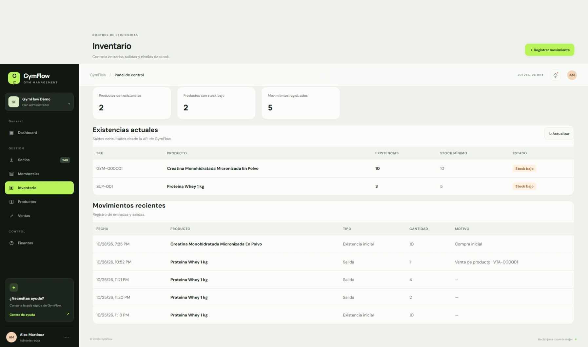
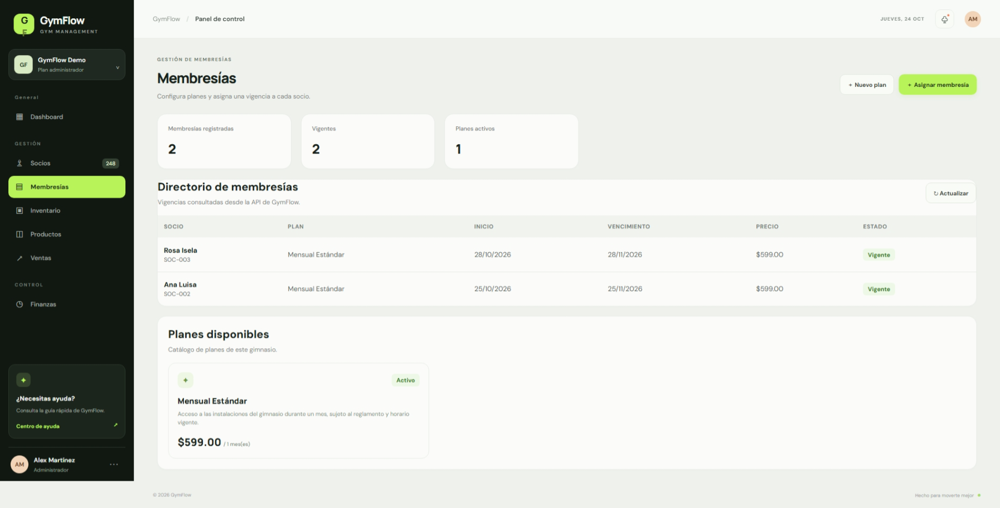
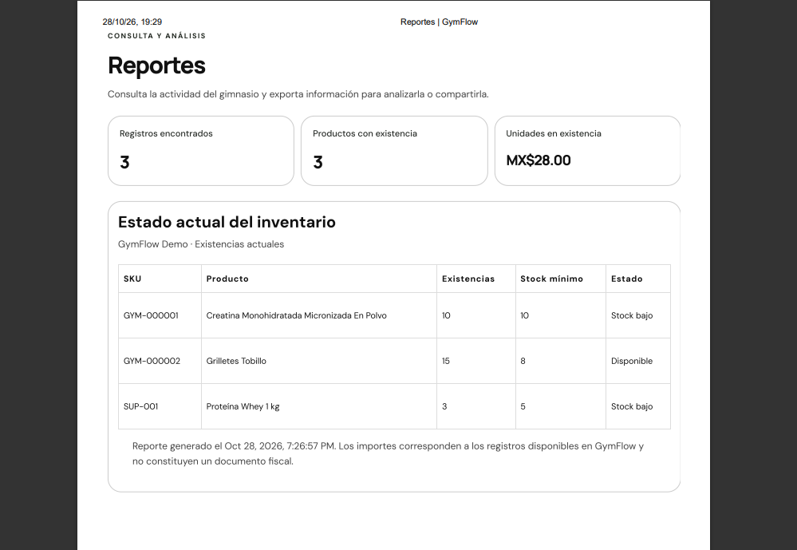
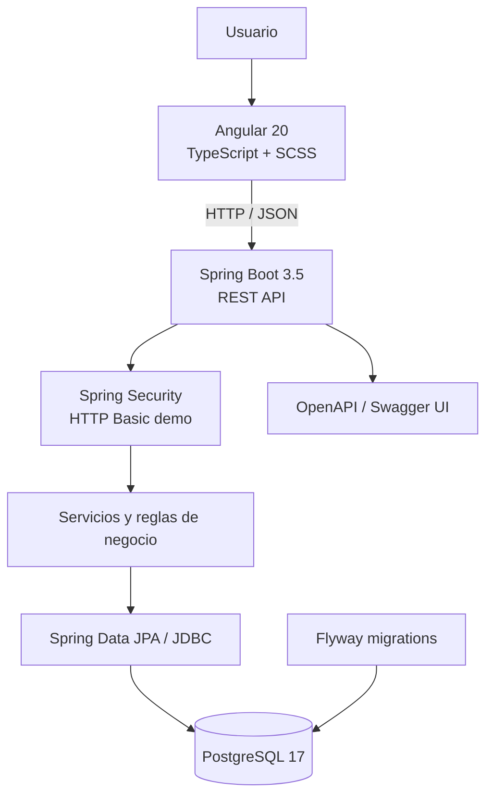

<div align="center">

# GymFlow

### Gestión integral de un gimnasio · Demo full-stack

Aplicación web demostrativa para administrar socios, membresías, catálogo, inventario, ventas y reportes desde una interfaz Angular conectada a una API REST con Spring Boot y PostgreSQL.

**Java 21 · Spring Boot 3.5 · Angular 20 · PostgreSQL 17 · Docker · Flyway**

</div>

---

## Acerca del proyecto

GymFlow es un proyecto de portafolio que representa los procesos operativos habituales de un gimnasio en una instalación de demostración. Su objetivo es mostrar diseño e implementación full-stack, persistencia relacional, reglas de negocio, transacciones, validaciones y documentación técnica.

> **Aviso:** es una demo académica/de portafolio. No está preparada para operar un gimnasio real ni para almacenar datos personales o financieros reales. No procesa pagos reales ni envía correos electrónicos.

## Funcionalidades

| Módulo | Capacidades |
|---|---|
| Socios | Alta, consulta y edición de socios. |
| Membresías | Creación de planes y asignación de membresías con fechas y estado. |
| Catálogo | Categorías, proveedores, productos, edición y validación de SKU. |
| Inventario | Existencias, carga inicial y movimientos de entrada/salida. |
| Ventas | Venta a socio o público general, detalle, folio `VTA-000001` y descuento de stock. |
| Historial | Registro consultable de cambios de producto. |
| Reportes | Consultas por periodo, paginación, exportación CSV e impresión/guardar como PDF desde el navegador. |
| Dashboard | Vista ilustrativa con datos estáticos de demostración; no representa indicadores calculados en tiempo real. |

### Reglas de negocio destacadas

- Una venta descuenta existencias y registra sus movimientos relacionados dentro de una transacción.
- Si una venta no puede completarse por falta de stock, la operación se rechaza y no debe dejar descuentos parciales.
- El inventario no permite existencias negativas.
- El SKU se valida para evitar duplicados dentro del gimnasio registrado.
- Los importes monetarios se manejan con `BigDecimal`/`NUMERIC`.
- La aplicación se presenta como una instalación demo de un solo gimnasio. La presencia de `gymId` en las rutas y el modelo de datos no equivale a una autorización multi-tenant completa.

## Capturas de la aplicación

Las siguientes imágenes corresponden a capturas de la demo funcional. Se incluyen para mostrar la interfaz real, no mockups.

| Inventario | Membresías | Reportes |
|---|---|---|
|  |  |  |

> La vista de reportes muestra el formato de impresión/guardar como PDF del navegador. La exportación tabular disponible es CSV.

## Arquitectura



### Tecnologías

**Backend**
- Java 21
- Spring Boot 3.5
- Spring Web, Validation, Data JPA y Spring Security
- PostgreSQL 17
- Flyway
- Springdoc OpenAPI / Swagger
- JUnit 5, Mockito y Testcontainers para pruebas

**Frontend**
- Angular 20
- TypeScript
- SCSS
- RxJS

**Entorno**
- Docker Compose para PostgreSQL local
- Maven para backend
- npm para frontend

## Requisitos previos

Instala las siguientes herramientas:

- JDK 21
- Maven 3.9 o superior
- Node.js y npm compatibles con Angular 20
- Docker Desktop con Docker Engine iniciado
- Git

Comprueba las instalaciones:

```bash
java -version
mvn -version
node -v
npm -v
docker version
```

## Ejecutar localmente

Clona el repositorio:

```bash
git clone https://github.com/TU_USUARIO/GymFlow.git
cd GymFlow
```

### 1. Iniciar PostgreSQL

Desde la raíz del proyecto:

```bash
cd gymflow-backend
docker compose up -d postgres
docker compose ps
```

El contenedor usa PostgreSQL 17 y un volumen Docker llamado `gymflow_pgdata` para conservar los datos entre reinicios.

### 2. Iniciar el backend

En la carpeta `gymflow-backend`:

```bash
mvn spring-boot:run
```

La API estará disponible en:

- API: `http://localhost:8080`
- Swagger UI: `http://localhost:8080/swagger-ui.html`
- OpenAPI JSON: `http://localhost:8080/v3/api-docs`

Flyway aplica las migraciones versionadas al iniciar la aplicación.

### 3. Iniciar el frontend

Abre otra terminal y entra en `gymflow-frontend`:

```bash
npm install
npm start
```

Abre:

`http://localhost:4200`

Mantén PostgreSQL, backend y frontend ejecutándose mientras utilizas la demo.

## Detener y reiniciar servicios

Detener frontend y backend: `Ctrl + C` en sus respectivas terminales.

Detener PostgreSQL sin borrar información:

```bash
cd gymflow-backend
docker compose stop postgres
```

Volver a iniciar PostgreSQL:

```bash
docker compose start postgres
```

Para detener y eliminar el contenedor y la red, conservando el volumen:

```bash
docker compose down
```

> **Cuidado:** `docker compose down -v` elimina también el volumen `gymflow_pgdata` y, por tanto, los datos locales persistidos. No ejecutes ese comando si quieres conservar tus registros.

## Configuración

El backend permite configurar la conexión y las credenciales mediante variables de entorno:

| Variable | Valor local predeterminado |
|---|---|
| `DB_URL` | `jdbc:postgresql://localhost:5432/gymflow` |
| `DB_USERNAME` | `gymflow` |
| `DB_PASSWORD` | `change-me-local-only` |
| `GYMFLOW_DEV_USER` | `devadmin` |
| `GYMFLOW_DEV_PASSWORD` | `change-me-local-only` |
| `PORT` | `8080` |

Los valores anteriores son exclusivamente para ejecución local. No publiques secretos ni uses estas credenciales en un entorno accesible desde Internet. La autenticación actual es HTTP Basic de demostración; no equivale a un sistema completo de cuentas, roles y recuperación de acceso.

## Pruebas automatizadas

Las pruebas están separadas para que el flujo habitual no dependa de Docker:

### Pruebas unitarias — sin Docker

Desde `gymflow-backend`:

```bash
mvn clean test
```

Este comando ejecuta las pruebas unitarias con JUnit/Mockito. Las pruebas de integración quedan excluidas por defecto.

### Pruebas de integración — requieren Docker

Con Docker Desktop iniciado:

```bash
mvn -Pintegration-tests clean verify
```

Esta ejecución activa `GymFlowIntegrationTest`, que utiliza Testcontainers para crear una instancia temporal de PostgreSQL. No utiliza ni elimina el volumen `gymflow_pgdata` de desarrollo.

Testcontainers y sus dependencias tienen alcance Maven `test`: no forman parte del runtime ni del artefacto de producción.

Los reportes Maven quedan en `gymflow-backend/target/surefire-reports/` y `gymflow-backend/target/failsafe-reports/`.

## Estructura del repositorio

```text
GymFlow/
├── gymflow-backend/
│   ├── src/main/java/com/gymflow/
│   │   ├── config/
│   │   ├── inventory/
│   │   ├── sale/
│   │   ├── member/
│   │   ├── membership/
│   │   └── ...
│   ├── src/main/resources/
│   │   ├── application.yml
│   │   └── db/migration/
│   ├── src/test/java/com/gymflow/
│   ├── docker-compose.yml
│   ├── Dockerfile
│   └── pom.xml
├── gymflow-frontend/
│   └── src/app/
├── docs/
│   └── TECHNICAL-DOCUMENTATION.md
└── README.md
```

## Alcance, seguridad y limitaciones

- Proyecto de demostración para una sola instalación/gimnasio.
- Autenticación HTTP Basic temporal; no hay gestión completa de usuarios, roles ni sesiones.
- No se integra una pasarela de pagos ni se realizan cargos reales.
- No se envían correos reales.
- Dashboard con información estática ilustrativa.
- Exportación de datos tabulares en CSV; no es un libro Excel `.xlsx` nativo.
- La opción PDF utiliza la impresión del navegador / guardar como PDF.
- No se debe exponer directamente en Internet con las credenciales locales.
- Antes de un uso productivo serían necesarios, entre otros, autenticación y autorización robustas, HTTPS, gestión segura de secretos, política de respaldos, observabilidad, revisión de seguridad y pruebas de aceptación.

## Documentación adicional

La documentación técnica ampliada se encuentra en [`docs/TECHNICAL-DOCUMENTATION.md`](docs/TECHNICAL-DOCUMENTATION.md). Los diagramas Mermaid de arquitectura, entidad–relación, casos de uso UML, flujos de venta/inventario/membresías, secuencia y despliegue están en [`docs/DIAGRAMS.md`](docs/DIAGRAMS.md). La evaluación de hosting y los prerrequisitos de seguridad están en [`docs/DEPLOYMENT.md`](docs/DEPLOYMENT.md). La guía para publicar y etiquetar la versión está en [`docs/GITHUB-RELEASE.md`](docs/GITHUB-RELEASE.md).

## Estado de validación

- Pruebas unitarias existentes: 12 aprobadas en la ejecución local compartida previamente.
- Suite de integración: incorporada; requiere ejecutar `mvn -Pintegration-tests clean verify` con Docker operativo.
- Frontend y módulos principales: validados manualmente por el usuario en la demo local.

---

<div align="center">

**GymFlow · Proyecto de portafolio**

Construido para demostrar desarrollo full-stack, reglas de negocio y persistencia transaccional.

</div>

## Login de demostración (Public Demo)

La demo incluye una pantalla de acceso inicial. Las credenciales están precargadas:

- Usuario: `demo@gymflow.com`
- Contraseña: `GymFlowDemo2026`

La sesión de frontend se conserva en `sessionStorage` hasta cerrar sesión o cerrar la pestaña. Las rutas de Angular redirigen al login cuando no hay sesión, y el botón de cierre de sesión está en el perfil lateral.

**Importante:** este acceso es una puerta de entrada de experiencia de usuario para una demo pública con datos ficticios. La validación de credenciales y el guard viven en Angular; el perfil backend `public-demo` continúa permitiendo acceso público a la API. No usar este mecanismo como autenticación ni protección de datos en producción. Para producción se debe implementar autenticación backend (por ejemplo, Spring Security con sesión segura o JWT), aplicar autorización a todos los endpoints y mantener secretos fuera del frontend.
