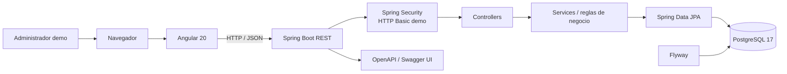
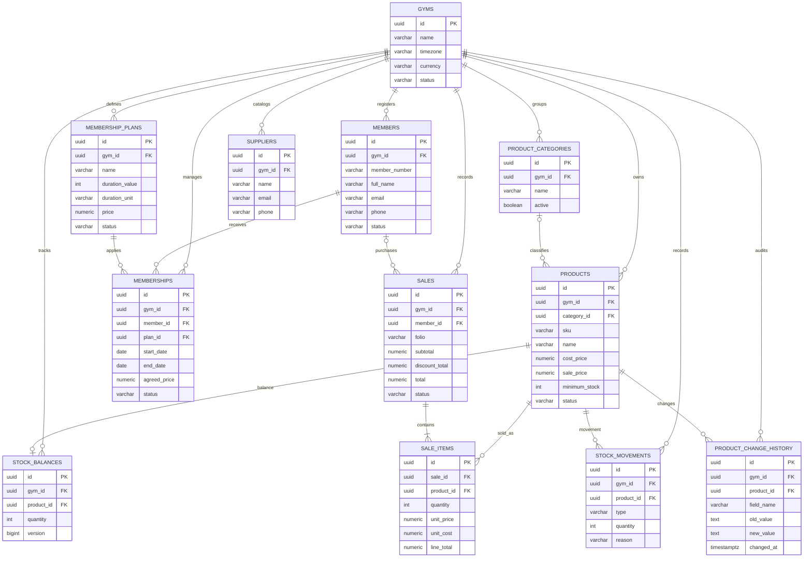
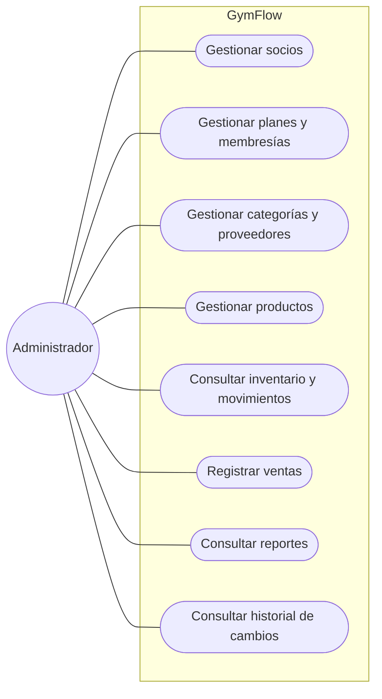
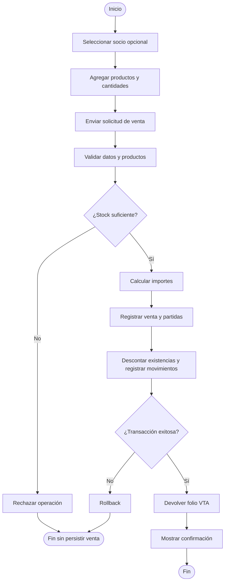
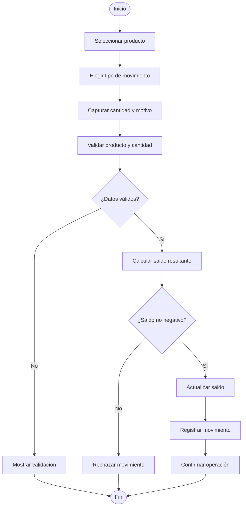
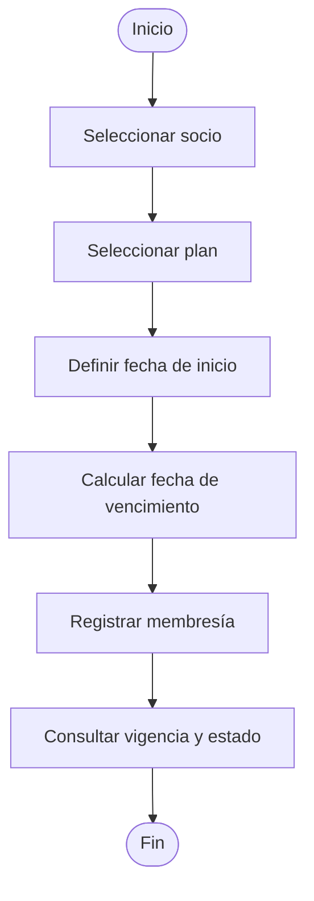
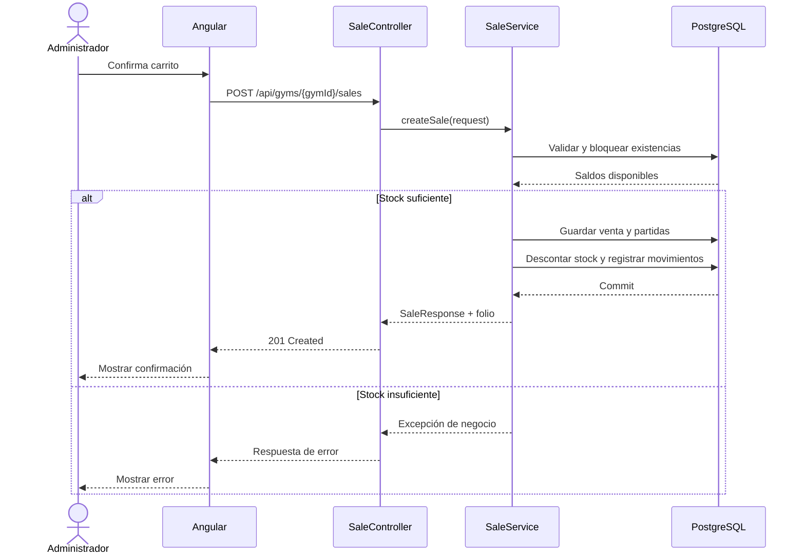
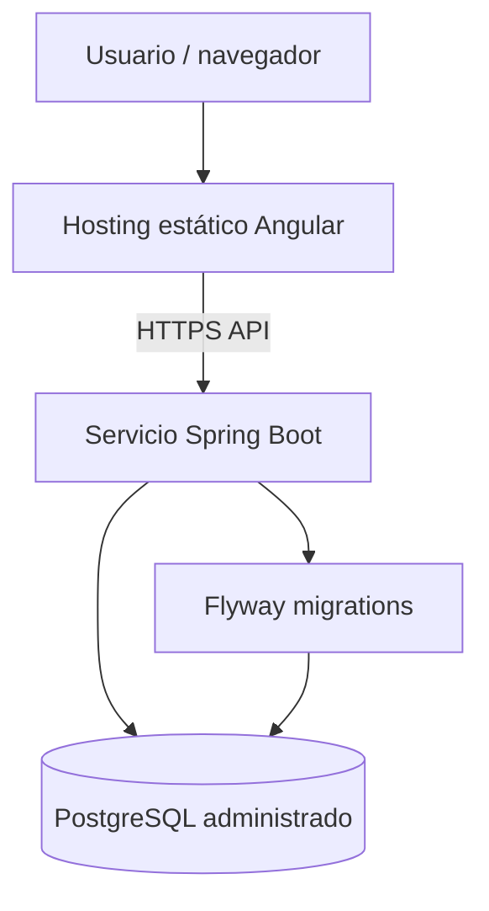

# GymFlow — diagramas de arquitectura y diseño

Los diagramas representan el esquema SQL de las migraciones Flyway `V1` a `V4` y los flujos implementados en la demo. No representan funcionalidades futuras como JWT, cobros reales o multi-tenancy completo.

## 1. Arquitectura lógica

## 2. Diagrama entidad–relación (ERD)

**Nota:** `suppliers` está modelada como catálogo independiente; las migraciones revisadas no definen una FK de proveedor en `products`. Las relaciones `GYMS` reflejan las FK declaradas en el esquema, no una afirmación de aislamiento multi-tenant completo.

## 3. Casos de uso (UML)

## 4. Flujo de venta

## 5. Flujo de inventario

## 6. Flujo de gestión de membresías

## 7. Secuencia de venta (UML)

## 8. Despliegue objetivo (pendiente de hardening)

Este diagrama es una arquitectura objetivo, no un despliegue existente. Antes de publicar la API se debe retirar el interceptor Angular que inyecta credenciales Basic fijas, configurar autenticación segura, HTTPS, secretos del proveedor y CORS restringido al dominio del frontend.
