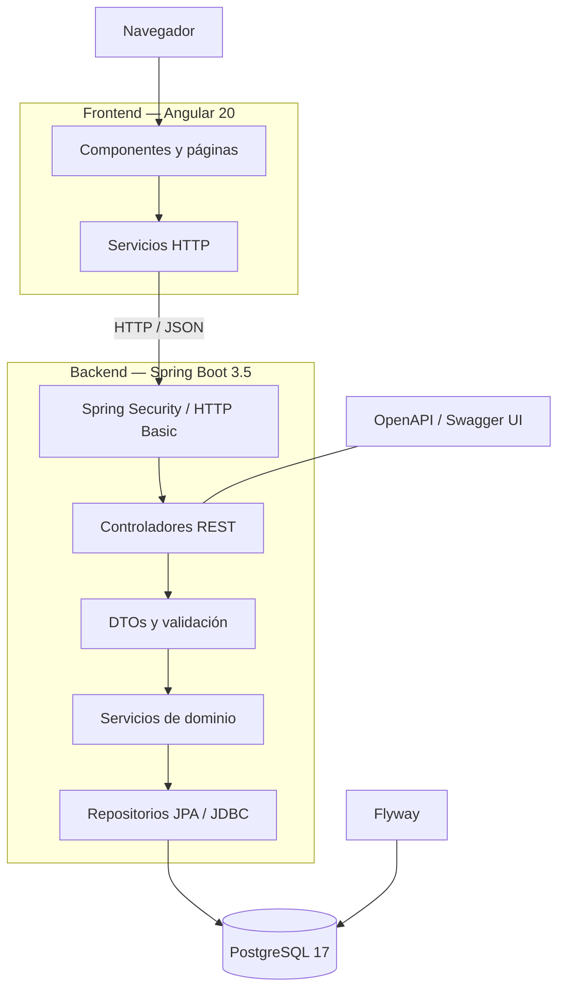
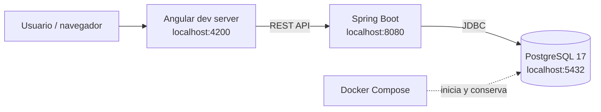
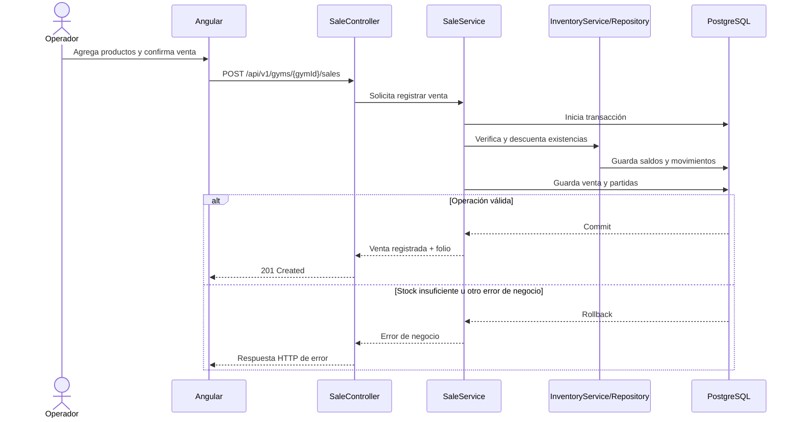
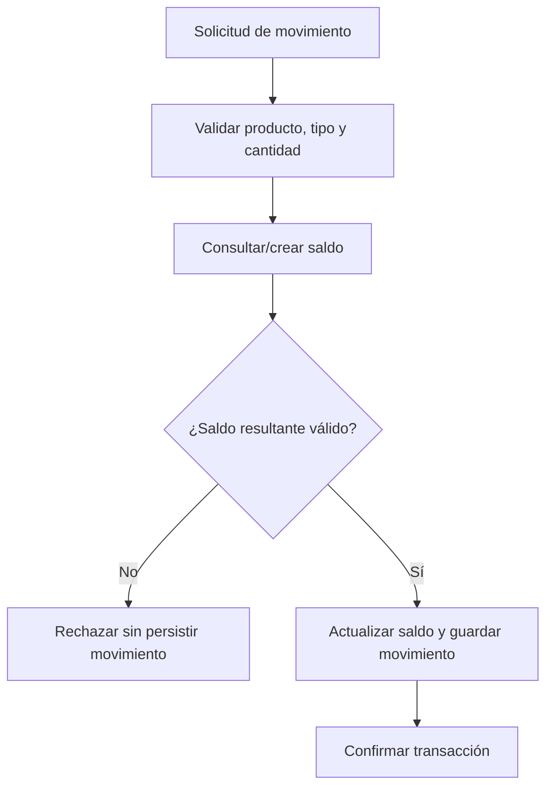
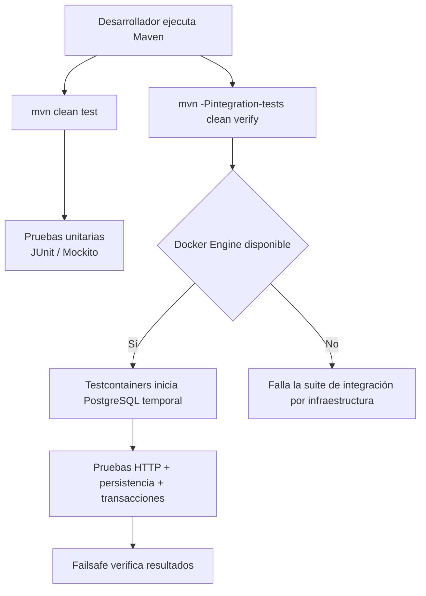
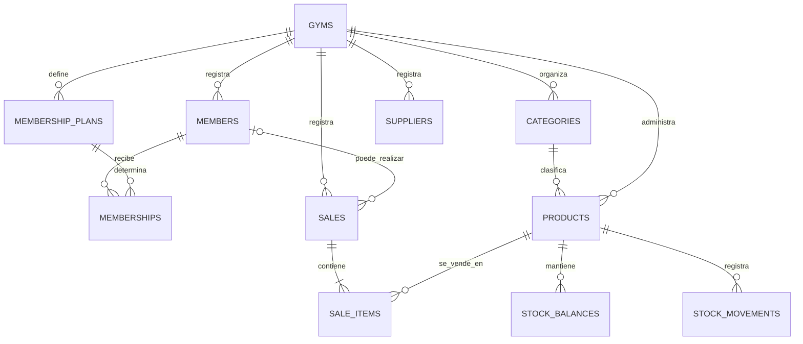

# GymFlow — Documentación técnica

**Versión documental:** 1.0  
**Proyecto:** GymFlow — Sistema de gestión de gimnasio (demo de una sola instalación)  
**Stack de referencia:** Java 21, Spring Boot 3.5, Angular 20, PostgreSQL 17, Flyway y Docker Compose.

> Este documento describe la implementación y el alcance identificables en el repositorio de la demo. Cuando una capacidad no está implementada o no se ha validado, se indica expresamente. No debe interpretarse como certificación de producción.

## 1. Propósito y alcance

GymFlow es una aplicación web full-stack de demostración para centralizar operaciones básicas de un gimnasio: socios, planes, membresías, catálogo de productos, inventario, ventas y reportes.

El alcance de esta versión es **una instalación de demostración para un gimnasio**. El modelo conserva relaciones mediante `gymId`, pero no se presenta como una solución multi-tenant lista para operar múltiples clientes o sucursales con aislamiento de seguridad.

### Objetivos

- Mostrar una arquitectura web separada en frontend, API REST y base de datos.
- Implementar reglas de negocio relevantes para inventario y ventas.
- Mantener la integridad de las operaciones mediante transacciones.
- Versionar el esquema relacional con Flyway.
- Exponer documentación de API con OpenAPI/Swagger.
- Incluir pruebas unitarias y una suite de integración opcional basada en PostgreSQL temporal.

### Fuera de alcance

- Cobros reales, integración bancaria o pasarela de pago.
- Envío real de correos o notificaciones.
- Gestión productiva de usuarios, roles, recuperación de contraseña y sesiones.
- Operación multi-tenant o autorización entre gimnasios.
- Dashboard analítico conectado a métricas reales (la vista actual es ilustrativa).
- Reconstrucción histórica del inventario a cualquier fecha.
- Archivo Excel nativo `.xlsx` (la exportación tabular disponible es CSV).

## 2. Actores

| Actor | Responsabilidad |
|---|---|
| Operador demo | Utiliza los módulos funcionales desde la interfaz. |
| Usuario autenticado de desarrollo | Accede a endpoints protegidos mediante HTTP Basic. |
| Administrador técnico | Configura servicios, base de datos, variables de entorno y despliegue local. |

La aplicación no implementa todavía un catálogo de roles de negocio. No atribuir permisos diferenciados que no estén presentes en el código.

## 3. Requisitos funcionales

Los requisitos siguientes describen capacidades del alcance actual. Su validación final debe realizarse en la interfaz y/o mediante API.

| ID | Requisito funcional | Estado / observación |
|---|---|---|
| RF-01 | Registrar y consultar la instalación/gimnasio de demostración. | API `/api/v1/gyms`. |
| RF-02 | Registrar, consultar y editar socios. | API de socios. |
| RF-03 | Crear planes de membresía. | API `/membership-plans`. |
| RF-04 | Asignar una membresía a un socio con fechas y estado. | API `/memberships`. |
| RF-05 | Registrar categorías y proveedores. | API de catálogo. |
| RF-06 | Registrar y consultar productos. | API `/products`. |
| RF-07 | Editar productos y validar el SKU duplicado. | Incluye historial de cambios de producto. |
| RF-08 | Registrar carga inicial de inventario y movimientos. | API `/inventory/movements`. |
| RF-09 | Consultar saldos de inventario. | API `/inventory/balances`. |
| RF-10 | Rechazar movimientos que provoquen existencias negativas. | Regla del servicio de inventario. |
| RF-11 | Registrar ventas para un socio o público general. | API `/sales`; `memberId` puede ser nulo según el contrato de integración. |
| RF-12 | Generar folio legible para las ventas. | Formato observado: `VTA-` con secuencia numérica. |
| RF-13 | Descontar inventario al completar una venta. | Operación transaccional. |
| RF-14 | Revertir la operación completa si una venta falla por falta de stock. | Debe validarse con suite de integración PostgreSQL. |
| RF-15 | Consultar ventas y reportes operativos. | Reportes disponibles en frontend. |
| RF-16 | Filtrar reportes por periodo y paginar resultados. | Alcance documentado en la interfaz actual. |
| RF-17 | Exportar resultados tabulares. | CSV delimitado; no `.xlsx` nativo. |
| RF-18 | Imprimir o guardar reportes como PDF desde el navegador. | Usa diálogo de impresión del navegador. |
| RF-19 | Mostrar un dashboard ilustrativo. | Datos estáticos; no usar como cifras reales. |
| RF-20 | Exigir autenticación para endpoints protegidos. | HTTP Basic temporal. Swagger y documentación API están permitidos por configuración. |

### Reglas de negocio clave

1. **Stock no negativo:** un movimiento de salida o venta no puede dejar el saldo por debajo de cero.
2. **Venta atómica:** cabecera, partidas, descuento de existencias y movimientos asociados deben confirmarse o revertirse como una sola operación.
3. **Folio legible:** la venta utiliza un folio humano, por ejemplo `VTA-000001`.
4. **SKU:** no se debe permitir un SKU duplicado dentro del ámbito del gimnasio asociado al producto.
5. **Dinero:** los importes monetarios usan precisión decimal (`BigDecimal` en Java y `NUMERIC` en PostgreSQL).
6. **Membresía:** la asignación relaciona socio y plan con fechas de inicio y fin.
7. **Demo:** los pagos son registros demostrativos; no representan una transacción financiera externa.

## 4. Requisitos no funcionales

| ID | Requisito | Criterio / situación |
|---|---|---|
| RNF-01 | Separación por capas | Frontend Angular, API Spring Boot y PostgreSQL. |
| RNF-02 | Persistencia relacional | PostgreSQL 17. |
| RNF-03 | Evolución del esquema | Migraciones SQL versionadas con Flyway. |
| RNF-04 | Validación de entradas | Spring Validation y restricciones del dominio. |
| RNF-05 | Seguridad de API | HTTP Basic temporal; no es suficiente para producción pública. |
| RNF-06 | Integridad transaccional | Servicios de ventas/inventario usan transacciones; validar rollback en integración. |
| RNF-07 | Documentación API | OpenAPI/Swagger. |
| RNF-08 | Portabilidad local | Docker Compose para base de datos; Maven y npm para aplicaciones. |
| RNF-09 | Mantenibilidad | Código organizado por dominios/paquetes y pruebas automatizadas. |
| RNF-10 | Usabilidad | Interfaz web responsive según validación manual; revisar todos los breakpoints antes de release. |
| RNF-11 | Configuración | Conexión y credenciales externalizables mediante variables de entorno. |
| RNF-12 | Protección de datos | Usar solo datos ficticios; no se ha establecido una certificación ni política formal de privacidad. |
| RNF-13 | Observabilidad | Logs de aplicación disponibles; monitoreo/alertas productivas no incluidos. |
| RNF-14 | Respaldo y recuperación | Depende del volumen local; estrategia automatizada de backups no incluida. |

## 5. Arquitectura lógica



### Responsabilidades

- **Angular:** presentación, formularios, navegación, tablas, filtros y comunicación HTTP.
- **Controladores REST:** reciben solicitudes y devuelven respuestas HTTP.
- **DTOs/Validation:** definen el contrato de entrada/salida y validan campos.
- **Servicios:** concentran reglas de negocio y límites transaccionales.
- **Repositorios:** acceso a datos mediante Spring Data JPA/JDBC.
- **PostgreSQL:** persistencia relacional.
- **Flyway:** aplica migraciones en orden al iniciar el backend.
- **Spring Security:** protege endpoints mediante HTTP Basic temporal.

## 6. Diagrama de despliegue local



## 7. Flujos principales

### 7.1 Registrar una venta



### 7.2 Registrar un movimiento de inventario



### 7.3 Ejecutar pruebas



## 8. Modelo de datos conceptual

El esquema relacional se define mediante las migraciones `V1` a `V4` ubicadas en `gymflow-backend/src/main/resources/db/migration/`.



El diagrama es conceptual y no pretende sustituir el DDL completo. Para nombres exactos, tipos, índices, restricciones y claves foráneas, consultar los scripts SQL Flyway.

### Migraciones actuales

| Migración | Propósito |
|---|---|
| `V1__initial_schema.sql` | Esquema base: gimnasio, socios, planes y catálogo/inventario. |
| `V2__memberships.sql` | Membresías. |
| `V3__sales.sql` | Ventas y partidas. |
| `V4__sales_folios_and_product_history.sql` | Folios legibles e historial de cambios de productos. |

## 9. API REST

Prefijo de recursos: `/api/v1`.

| Recurso | Ruta base |
|---|---|
| Gimnasios | `/api/v1/gyms` |
| Socios | `/api/v1/gyms/{gymId}/members` |
| Planes | `/api/v1/gyms/{gymId}/membership-plans` |
| Membresías | `/api/v1/gyms/{gymId}/memberships` |
| Categorías | `/api/v1/gyms/{gymId}/categories` |
| Proveedores | `/api/v1/gyms/{gymId}/suppliers` |
| Productos | `/api/v1/gyms/{gymId}/products` |
| Historial de producto | `/api/v1/gyms/{gymId}/products/{productId}/history` |
| Saldos | `/api/v1/gyms/{gymId}/inventory/balances` |
| Movimientos | `/api/v1/gyms/{gymId}/inventory/movements` |
| Ventas | `/api/v1/gyms/{gymId}/sales` |

La definición de operaciones, esquemas y códigos de respuesta se puede explorar en Swagger UI: `http://localhost:8080/swagger-ui.html`.

## 10. Seguridad

### Implementado

- Spring Security.
- HTTP Basic para endpoints autenticados.
- Swagger UI y OpenAPI permitidos por la configuración actual.
- Credenciales configurables por variables de entorno.

### Limitaciones

- No hay módulo completo de registro/login de usuarios.
- No hay roles de negocio diferenciados.
- HTTP Basic es temporal y no debe exponerse directamente en Internet sin HTTPS y controles adicionales.
- No se implementa autorización por identidad para un contexto multi-tenant.
- Deshabilitar CSRF es una decisión de la API actual; debe revisarse si cambia el tipo de autenticación o el cliente.
- Las credenciales locales no deben reutilizarse en un entorno compartido.

### Recomendaciones previas a producción

1. Autenticación robusta y almacenamiento seguro de contraseñas.
2. Autorización basada en roles/permisos.
3. HTTPS y configuración CORS restrictiva.
4. Gestión de secretos fuera del repositorio.
5. Rate limiting, auditoría y políticas de sesión.
6. Revisión de dependencias y análisis de vulnerabilidades.
7. Backups probados y política de retención.
8. Pruebas de seguridad y aceptación.

## 11. Estrategia de pruebas

### 11.1 Pruebas unitarias (sin Docker)

Clases actuales:

- `CreateSaleRequestTest`
- `SaleServiceTest`
- `InventoryServiceTest`

La ejecución local previamente compartida reportó 12 pruebas exitosas (7 inventario, 3 contrato/validación de solicitud de venta, 2 servicio de ventas).

Comando:

```bash
mvn clean test
```

### 11.2 Pruebas de integración (Docker requerido)

Clase:

- `GymFlowIntegrationTest`

Usa Testcontainers y PostgreSQL temporal para validar endpoints protegidos, persistencia y escenarios transaccionales. Se ejecuta de manera explícita:

```bash
mvn -Pintegration-tests clean verify
```

El perfil `integration-tests` está separado del flujo unitario por defecto. Las dependencias Testcontainers tienen scope `test`; no se empaquetan en el runtime de la aplicación.

### 11.3 Regresión manual de frontend

| Área | Validación sugerida |
|---|---|
| Socios | Alta, consulta, edición y persistencia tras recargar. |
| Membresías | Crear plan, asignar socio y verificar fechas/estado. |
| Catálogo | Categorías, proveedores, alta y edición de producto. |
| SKU | Intentar duplicado y confirmar mensaje de validación. |
| Inventario | Carga inicial, entradas, salidas y saldo. |
| Ventas | Agregar artículo al carrito, confirmar, revisar folio, total y stock. |
| Stock insuficiente | Confirmar que no se crea venta parcial ni stock negativo. |
| Reportes | Periodos, filtros, paginación, CSV e impresión/PDF. |
| Persistencia | Reiniciar frontend/backend y verificar que los datos siguen en PostgreSQL. |
| Dashboard | Recordar que sus cifras son ilustrativas/estáticas. |

## 12. Instalación, configuración y operación

La guía paso a paso de ejecución está en el README raíz. Resumen de comandos:

```bash
# PostgreSQL
cd gymflow-backend
docker compose up -d postgres

# Backend (otra terminal)
mvn spring-boot:run

# Frontend (otra terminal)
cd gymflow-frontend
npm install
npm start
```

Detener PostgreSQL sin borrar volumen:

```bash
cd gymflow-backend
docker compose stop postgres
```

No utilizar `docker compose down -v` si se desean conservar datos locales.

## 13. Requisitos de entorno y despliegue

### Desarrollo local

- JDK 21.
- Maven 3.9+.
- Node.js/npm compatibles con Angular 20.
- Docker Desktop y PostgreSQL 17 vía Compose.

### Despliegue demo

La arquitectura permite desplegar frontend, backend y PostgreSQL como servicios separados, pero el repositorio no debe presentarse como una publicación productiva ya desplegada o endurecida. Antes de publicar una demo accesible desde Internet:

- Configurar secretos distintos a los locales.
- Restringir el acceso a la base de datos.
- Configurar HTTPS y CORS.
- Proteger o limitar Swagger en entornos compartidos si corresponde.
- Configurar almacenamiento persistente y backups.
- Usar datos ficticios.
- Implementar autenticación/autorización adecuada.
- Ejecutar pruebas funcionales y de seguridad.

## 14. Decisiones técnicas y trade-offs

| Decisión | Motivo |
|---|---|
| Monolito modular Spring Boot | Mantiene el despliegue y la comprensión del dominio simples para una demo. |
| Angular separado | Separa presentación y API; permite evolucionar frontend/backend de forma independiente. |
| PostgreSQL | Persistencia relacional y restricciones transaccionales. |
| Flyway | Cambios de esquema versionados y reproducibles. |
| BigDecimal / NUMERIC | Evita errores de precisión binaria en importes. |
| Transacciones en ventas | Evita inconsistencias entre venta, partidas y stock. |
| Testcontainers opcional | Prueba contra PostgreSQL real sin depender de una base compartida. |
| HTTP Basic temporal | Simplifica la demo técnica; se reconoce explícitamente que no es seguridad de producción. |

## 15. Prompts de referencia para generar un proyecto similar

Los siguientes prompts son **plantillas reutilizables** redactadas para describir el alcance y las restricciones de GymFlow. No se presentan como transcripción literal del historial original de desarrollo.

### Prompt 1 — Generación inicial del proyecto

> Actúa como arquitecto de software y desarrollador full-stack senior. Diseña una aplicación web de demostración llamada GymFlow para administrar un único gimnasio. Utiliza Java 21, Spring Boot 3, Spring Data JPA, Spring Security, PostgreSQL, Flyway y Angular con TypeScript/SCSS. Implementa módulos de socios, planes, membresías, categorías, proveedores, productos, inventario, ventas y reportes. Mantén una arquitectura monolítica modular, una API REST versionada y documentación OpenAPI. Prioriza simplicidad, consistencia, validación de datos y reglas de negocio explícitas. No agregues microservicios ni funcionalidades no solicitadas. No integres cobros ni correos reales. Usa datos ficticios para la demo. Entrega estructura de carpetas, entidades, DTOs, repositorios, servicios, controladores, migraciones, componentes frontend y README. No inventes campos ni contratos: define primero el modelo y verifica consistencia entre capas.

### Prompt 2 — Reglas de inventario y ventas

> Implementa inventario y punto de venta en GymFlow. Un producto debe tener SKU, nombre, costo, precio, stock mínimo y categoría opcional. Registra movimientos trazables de inventario y mantiene el saldo actual. No permitas stock negativo. Para una venta, registra cabecera, partidas, folio legible y método de pago demostrativo. Descuenta existencias y guarda movimientos de salida dentro de una única transacción. Si cualquier artículo no tiene stock suficiente, revierte toda la operación y no dejes una venta parcial. Usa BigDecimal en Java y NUMERIC en PostgreSQL. Agrega validaciones y pruebas unitarias e integración. No modifiques módulos ya validados sin una razón demostrable.

### Prompt 3 — Calidad y pruebas

> Revisa el proyecto existente antes de modificarlo. No supongas nombres de métodos, constructores, DTOs, rutas ni relaciones: inspecciona el código y las migraciones reales. Diseña pruebas unitarias con JUnit 5 y Mockito para reglas de dominio. Diseña pruebas de integración con Spring Boot Test, MockMvc y Testcontainers/PostgreSQL para persistencia, seguridad y rollback. Mantén las pruebas de integración separadas de las unitarias para que `mvn clean test` no requiera Docker y usa un perfil Maven explícito para integración. No alteres la lógica productiva para hacer pasar mocks incorrectos. Reporta claramente pruebas ejecutadas, fallos y limitaciones del entorno.

### Prompt 4 — Documentación y entrega para portafolio

> Documenta el proyecto para que un desarrollador o reclutador pueda entender su propósito y ejecutarlo localmente. Incluye resumen, stack, funcionalidades, reglas de negocio, arquitectura, estructura de carpetas, requisitos previos, pasos para PostgreSQL/backend/frontend, variables de entorno, Swagger, pruebas, persistencia Docker, comandos de apagado seguro, limitaciones y estado de validación. Crea además documentación técnica con requisitos funcionales y no funcionales, actores, casos de uso, diagramas Mermaid, modelo de datos conceptual, endpoints, seguridad, estrategia de pruebas, decisiones técnicas y prompts de referencia. Distingue explícitamente las funciones implementadas de las pendientes. No afirmes que el sistema está listo para producción si no se han completado autenticación, autorización, backups, HTTPS y revisión de seguridad.

### Prompt 5 — Revisión de regresión

> Realiza una revisión de regresión sobre el proyecto sin alterar comportamientos aprobados. Verifica socios, membresías, productos, edición/SKU, movimientos de inventario, ventas, descuento de stock, reportes, exportación y persistencia. Primero identifica los módulos afectados por cada cambio. Ejecuta pruebas automatizadas y prepara una lista de validación manual de frontend. Si detectas un defecto, realiza el cambio mínimo, agrega una prueba que reproduzca el problema y documenta qué archivos fueron modificados. No cambies el dashboard estático ni amplíes el alcance sin autorización.

## 16. Casos de uso resumidos

| ID | Caso de uso | Actor principal |
|---|---|---|
| CU-01 | Consultar instalación/gimnasio demo | Operador demo |
| CU-02 | Registrar socio | Operador demo |
| CU-03 | Consultar/editar socio | Operador demo |
| CU-04 | Crear plan de membresía | Operador demo |
| CU-05 | Asignar membresía a socio | Operador demo |
| CU-06 | Registrar categoría | Operador demo |
| CU-07 | Registrar proveedor | Operador demo |
| CU-08 | Registrar producto | Operador demo |
| CU-09 | Editar producto | Operador demo |
| CU-10 | Consultar historial de producto | Operador demo |
| CU-11 | Registrar inventario inicial | Operador demo |
| CU-12 | Registrar entrada/salida de inventario | Operador demo |
| CU-13 | Consultar existencias | Operador demo |
| CU-14 | Registrar venta | Operador demo |
| CU-15 | Consultar ventas | Operador demo |
| CU-16 | Consultar y exportar reportes | Operador demo |

## 17. Pendientes antes de considerar una versión productiva

- Autenticación y autorización completas.
- Gestión de roles y permisos.
- Revisión de seguridad y exposición de endpoints.
- Configuración HTTPS/CORS/secretos.
- Estrategia de backup/restore probada.
- Observabilidad, logs estructurados y alertas.
- Pruebas de aceptación end-to-end del frontend.
- Dashboard con métricas reales si se requiere.
- Revisión de accesibilidad y responsive en dispositivos objetivo.
- Pipeline CI para build y pruebas unitarias/integración.
- Despliegue demo reproducible y validado en el proveedor elegido.

## 18. Glosario

| Término | Definición |
|---|---|
| API REST | Interfaz HTTP para comunicación entre Angular y Spring Boot. |
| DTO | Objeto de transferencia de datos de entrada/salida. |
| Flyway | Herramienta de migraciones versionadas de base de datos. |
| JPA | Especificación Java para persistencia relacional. |
| SKU | Código único de identificación de producto dentro del catálogo. |
| Stock balance | Saldo actual de unidades disponibles. |
| Stock movement | Registro de entrada, salida o carga de inventario. |
| Testcontainers | Biblioteca que levanta dependencias reales en contenedores durante pruebas. |
| Transacción | Unidad atómica de operaciones de base de datos. |

---

**Fin de la documentación técnica.**
